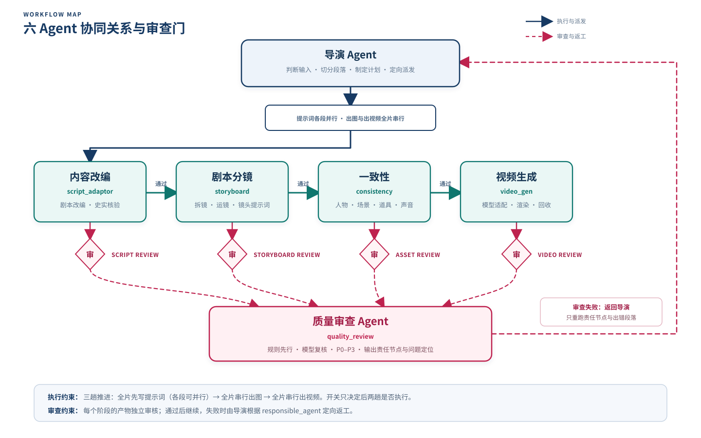

# 漫簇 Mancu

把一本书、一份长资料或一段创作要求，做成一部可交付的人物纪录片。

六个 Agent 依次推进：导演先读材料、给出计划并切分段落；内容改编、剧本分镜、一致性、视频生成逐段生产；每一道工序结束时都有质量审查把关。审查不通过，只打回它点名的那一段、只重跑那一个环节，不会把整条流水线推倒重来。


**这是源码版**：需要本机装有 64 位 Python 3.11 或更高版本。首次双击 `start.cmd` 时，启动器会在项目目录下建立独立的 `.venv`、按国内镜像顺序安装依赖，然后拉起服务；前端产物已经随仓库提供，日常使用不需要 Node.js。

---

## 目录

- [它解决什么问题](#它解决什么问题)
- [主要功能](#主要功能)
- [六个 Agent](#六个-agent)
- [工作流程](#工作流程)
- [界面](#界面)
- [技术栈](#技术栈)
- [目录结构](#目录结构)
- [环境要求](#环境要求)
- [安装与启动](#安装与启动)
- [配置模型](#配置模型)
- [使用说明](#使用说明)
- [数据、备份与迁移](#数据备份与迁移)
- [HTTP API](#http-api)
- [开发与测试](#开发与测试)
- [常见问题](#常见问题)
- [隐私与安全](#隐私与安全)

---

## 它解决什么问题

用大模型直接写"历史人物纪录片脚本"，会稳定地掉进四个坑。这个项目的重心不是"调用模型生成内容"，而是把生成过程约束成可审查、可返工、可复现的流水线。

| 坑 | 表现 | 本项目的做法 |
|---|---|---|
| **史实幻觉** | 把传说当史实，年份、人物、地点随手编 | 内容改编阶段把 `historical_facts` 与 `unverified_facts` 分字段输出，未核实内容不混进史实 |
| **一致性崩塌** | 同一个角色，第 3 个镜头换了张脸 | 一致性 Agent 先建立人物四视图、场景、道具参考资产，后续镜头引用资产而不是重新描述 |
| **错误发现得太晚** | 分镜错了，等四个镜头渲染完才发现，钱已经花掉 | 审查门放在**每两道工序之间**：脚本错只花一次文本调用，不会等到渲染完 |
| **提示词不可复用** | 为某个模型调好的提示词，换模型就废 | 同时保留 `storyboard_prompt`（原始）与 `final_video_prompt`（适配后），原始永不被覆盖 |

适合的使用者：需要把长文本做成系列短片、对史实准确性和画面一致性有要求、又希望每一步都能人工干预的内容制作者。

## 主要功能

- **长文本改编**：输入一本书、一份资料，或一句带主题的要求，导演判断输入类型、选择工作流并切分段落。
- **一套完整提示词**：剧本、分镜、人物/场景/道具资产提示词、视频提示词逐段产出。不配置生图与生视频也能拿到全套可复用的提示词。
- **可选的媒体生成**：图片与视频是两个独立开关，默认关闭；关掉时只产出提示词与校验，不产生任何生成费用。
- **三档审核强度**：`STRICT`（逐项核对事实与来源）、`NORMAL`（默认，阻断 P0/P1）、`FAST`（仅阻断 P0），可按任务选择。
- **严格的串行媒体队列**：图片和视频都按"发一条 → 等待 → 落盘确认 → 发下一条"执行，不会同时向上游提交多条请求。
- **审查与定向返工**：每道工序后有质量审查；不通过时只重跑被点名的那一段、那一个环节，返工次数可设 0–3 次。
- **本地资料库**：上传书籍或文档后分块入库，内置中文向量模型做语义检索，命中结果按字符二元组兜底；条目经人工"入库/放弃"后才算可信知识。
- **来源校验**：联网检索只接受权威站点白名单，查不到就明确说查不到，不拿百科条目充数。
- **模型供应商管理**：界面里填写 OpenAI 兼容地址与 Key，测试连接、扫描该 Key 可用的模型并按能力分类（文本 / 视觉 / 生图 / 生视频）。
- **免费模型中继**（可选）：把多个供应商、多个账号聚合成一个 OpenAI 兼容端点，供 Agent 轮换使用，凭据只在服务端。
- **飞书连接器**（可选）：从飞书文档取任务素材，需要自建应用凭据。
- **可观测**：任务、步骤、产物、日志、历史记录都在网页里；可一键导出诊断包（日志 + 环境 + 脱敏配置）。

## 六个 Agent

| Agent | 职责 | 需要的模型能力 |
|---|---|---|
| 导演 `director` | 判断输入类型、选择工作流、切分段落、给出制作计划 | 文本 + 视觉（读素材图片） |
| 内容改编 `script_adaptor` | 把材料改写成可拍摄的剧本，史实与未核实内容分字段 | 文本 |
| 剧本分镜 `storyboard` | 逐段写镜头、构图、人物动作与提示词 | 文本 |
| 一致性 `consistency` | 建立人物四视图、场景与道具参考资产供后续引用 | 文本 + 生图 |
| 视频生成 `video_gen` | 把镜头提示词适配为具体模型的视频提示词并生成 | 文本 + 生视频 |
| 质量审查 `quality_review` | 每道工序后判定通过或打回，并指出该返工哪一环 | 文本 + 视觉（判定渲染画面） |

设置页会根据上表给每个 Agent 标注"需视觉模型 / 需生图模型 / 需生视频模型"，可以直接看出哪些环节会产生图像与视频费用。

## 工作流程



```
导演 director            一次        判断输入、选工作流、切分段落
┌ 逐段文本与提示词工作 ───────────────────────────────────────┐
│ 内容改编  → 质量审查(剧本)                                    │
│ 剧本分镜  → 质量审查(分镜)                                    │
│ 一致性    → 质量审查(资产)                                    │
└────────────────────────────────────────────────────────────┘
图片生成                 一次        全片串行队列，落盘成功才发下一条
视频提示词               逐段        汇总并审查每条最终提示词，不渲染
视频生成                 一次        全片串行队列，一段一镜依次执行
成片合成                 一次        配音回退、字幕、拼接（本地 ffmpeg）
```

两点需要说明：

1. **文本与提示词可以并发，媒体必须串行。** 分段之间在文本阶段没有依赖，可以同时跑（并发上限由 `STUDIO_MAX_CONCURRENCY` 控制，默认 2）；图片和视频共享参考资产、共享供应商限流，顺序是真实依赖，所以走全片串行队列。
2. **返工是分段的。** 审查失败只重跑它指定的 Agent 和该段，第 2 段的问题不会让第 1 段重新渲染；单个阶段对超时、限流这类瞬时故障会自动重试，鉴权失败、余额不足这类确定性错误不重试。

## 界面

浏览器打开后有三个页面：

| 路径 | 内容 |
|---|---|
| `/` | 工作台：新建任务、看计划与步骤流、审查结果、产物预览、日志 |
| `/settings` | 设置：供应商与 Key、模型分配与能力标注、资料库与检索、功能开关 |
| `/relay` | 中继：多供应商多账号聚合与健康检查（可选功能） |

工作台的核心交互只有一条主线：**提交材料 → 创建任务 → 观察步骤与产物 → 需要时介入**。导演在信息不足时会在任务里反问，回答后继续；任何一步都可以取消或重试。

## 技术栈

| 层 | 选型 | 为什么 |
|---|---|---|
| HTTP 服务 | FastAPI + uvicorn | 管线里大量并发等待（模型、渲染、轮询），同步框架会被 I/O 拖死 |
| 任务执行 | asyncio 后台任务（同进程） | 单机只跑一两个任务，状态机存在 SQLite 里，进程重启后任务仍可查看和续跑 |
| 存储 | SQLite（单写者 + 进程内写锁） | 没有独立数据库服务、消息队列、Redis，启动就是一个进程 |
| 语义检索 | onnxruntime + tokenizers + bge-small-zh-v1.5（int8，24 MB） | 模型随仓库提供，进程内推理，不需要额外的向量数据库或 Key |
| 画面校验 | scikit-image（SSIM） | 一致性检查要给出可解释的相似度，而不是再问一次模型"像不像" |
| 前端 | React 19 + esbuild | 产物是单个 bundle，后端直接托管，部署没有额外进程 |
| Python | 3.11 及以上，64 位 | 启动器在 `py -3.14` 到 `py -3.11` 之间挑已安装的最高版本 |
| 模型接入 | OpenAI 兼容 HTTP 接口 | 文本、视觉、生图、生视频都按同一套地址 + Key 配置 |

可选的外部依赖有两处：媒体网关（`MANCU_MEDIA_BASE_URL`，默认 `http://127.0.0.1:3300`）是独立服务，不由本项目启动，不配置也能跑，只是不出图不出片；成片拼接需要系统 PATH 里有 `ffmpeg`，没有时视频镜头照常生成并保留，只跳过拼接。

## 目录结构

```
Mancu/
├─ start.cmd                    启动入口（双击这个）
├─ start.ps1                    启动器：选 Python、建 .venv、装依赖、拉起服务
├─ stop.cmd                     停止服务（只结束本项目的进程）
├─ DEPLOY.md                    部署、备份、升级、排错手册
├─ SOURCE-INFO.txt              源码版说明
├─ .env.example                 环境变量清单模板（程序不自动读取，供抄写）
├─ .gitignore / .gitattributes  忽略规则与换行符约定
├─ docs/
│  ├─ INSTALL.md                安装细节：镜像、离线、参数、常见失败
│  └─ six-agent-review-flow.svg 六 Agent 与审查门流程图
├─ backend/
│  ├─ app/
│  │  ├─ api/                   HTTP 端点：doc / knowledge / settings / mcp / relay / diagnostics
│  │  ├─ agents/                Agent 基类与工具回路
│  │  ├─ doc/                   纪录片管线：六 Agent、提示词、审查、媒体、合成
│  │  ├─ kb/                    资料库：分块、向量、来源白名单、联网检索
│  │  ├─ connectors/            外部连接器（飞书文档）
│  │  ├─ platform/              执行器、Agent 注册表、MCP 工具、RAG
│  │  ├─ tools/                 模型调用与传输重试
│  │  ├─ main.py                应用入口：路由、静态托管、上传
│  │  ├─ serve.py               启动器：先装日志，再起 uvicorn
│  │  ├─ config.py              路径与运行时配置
│  │  ├─ db.py                  SQLite 结构与访问
│  │  ├─ logs.py                日志：轮转、结构化事件、脱敏
│  │  └─ relay.py               渠道聚合代理
│  ├─ config/                   机器配置：providers.json 等（含密钥，不入库）
│  ├─ models/                   内置向量模型 bge-small-zh-v1.5-onnx（24 MB）
│  ├─ skills/                   可插拔能力，一个 skill 一个子目录
│  ├─ tests/                    测试套件
│  ├─ userdata/                 你的数据：studio.db、uploads、assets、videos（不入库）
│  └─ requirements.txt          Python 依赖清单
├─ frontend/
│  ├─ src/                      React 源码（页面、组件、API 封装）
│  ├─ public/logo.svg
│  ├─ index.html
│  ├─ build.mjs                 esbuild 构建脚本
│  ├─ package.json
│  ├─ tsconfig.json
│  └─ dist/                     已构建产物：bundle.js / bundle.css / index.html / logo.svg
├─ .venv/                       首次启动时自动创建（不入库）
└─ logs/                        启动日志：start-powershell.log（首次运行时创建）
```

## 环境要求

| 项目 | 最低要求 | 推荐 |
|---|---|---|
| 操作系统 | Windows 10 / 11，64 位 | Windows 11 64 位 |
| PowerShell | 5.1 | 5.1 或 7 |
| Python | 3.11，64 位 | 3.13，64 位 |
| 内存 | 8 GB | 16 GB |
| 磁盘 | 2 GB（不含生成的图片与视频） | 10 GB 以上 |
| Node.js | 日常启动不需要 | 重建前端时用 20 或更高 |
| 网络 | 首次安装依赖、调用在线模型时需要 | 稳定网络 |

当前验证基线是 Windows 11 64 位 + PowerShell 5.1 + Python 3.13.9。Linux 与 macOS 没有提供启动入口；`start.ps1` 是 PowerShell 脚本，Windows 以外的环境需要自行用 `python -m app.serve` 拉起，并自行安装依赖。

## 安装与启动

### 1. 安装 Python

装 64 位 Python 3.11 或更高版本（推荐 3.13），安装时勾选 **Add python.exe to PATH**。装完重新打开一个 PowerShell 确认：

```powershell
py -3.13 --version
```

没有 `py` 命令时用 `python --version`。启动器会同时尝试 `py -3.14 / -3.13 / -3.12 / -3.11` 和 PATH 上的 `python.exe`，取其中可用的最高版本；32 位的 Python 会被直接排除。

### 2. 解压并启动

把仓库完整解压到普通文件夹（路径尽量短，允许空格与中文），双击根目录的 **`start.cmd`**。

首次启动会自动完成：

1. 检查 64 位系统与 PowerShell 版本；
2. 在项目目录建立 `.venv`（已存在且版本够新就复用，否则重建）；
3. 比对 `requirements.txt` 的 SHA-256 指纹，逐项导入 FastAPI、Uvicorn、Pydantic、HTTPX、NumPy、Pillow、scikit-image、ONNX Runtime、tokenizers，并执行 `pip check`；
4. 缺依赖时按 **清华 → 阿里云 → 腾讯 → 官方 PyPI** 的顺序安装，任意一级成功即停；
5. 检查 `frontend\dist\bundle.js`，存在就直接用（缺失或加了 `-Build` 才装 Node 依赖并重建）；
6. 启动后端，等端口就绪后打开浏览器 <http://127.0.0.1:8100>。

首次安装要下载依赖，视网络情况需要几分钟；之后启动是秒级。全过程记录在 `logs\start-powershell.log`。

**启动窗口要保持打开**，关掉窗口或按 `Ctrl+C` 即停止服务。

### 3. 高级参数

需要换端口、换监听地址或只做体检时，在项目目录打开 PowerShell：

```powershell
powershell -NoProfile -ExecutionPolicy Bypass -File .\start.ps1 -Port 8200
powershell -NoProfile -ExecutionPolicy Bypass -File .\start.ps1 -NoBrowser
powershell -NoProfile -ExecutionPolicy Bypass -File .\start.ps1 -CheckOnly
powershell -NoProfile -ExecutionPolicy Bypass -File .\start.ps1 -Help
```

| 参数 | 作用 |
|---|---|
| `-Port 8200` | 换监听端口（默认 8100） |
| `-ListenHost 0.0.0.0` | 监听局域网地址，暴露前请先加防火墙与访问控制 |
| `-Build` | 强制重建前端（需要 Node.js 20+） |
| `-NoBrowser` | 不自动打开浏览器 |
| `-CheckOnly` | 只检查环境与依赖，不启动服务 |
| `-Offline` | 从 `backend\wheels` 离线安装依赖 |
| `-PrepareOffline` | 下载依赖到 `backend\wheels` 后退出，供离线机器使用 |
| `-OfficialSources` | 跳过国内镜像，只用官方 PyPI / npm |
| `-Mirror <URL>` | 指定单个 pip 源 |
| `-NonInteractive` | 出错后不等待回车（`start.cmd` 默认带上） |

### 4. 停服务

优先在启动窗口按 `Ctrl+C`；也可以双击 `stop.cmd`，或指定端口：

```bat
stop.cmd
stop.cmd 8200
```

`stop.cmd` 只结束能识别为本项目的 Python 进程；端口被别的程序占用时它会报出 PID 与进程名并拒绝误杀。

### 5. 离线安装

在一台系统架构与 Python 版本一致、且能联网的机器上执行：

```powershell
powershell -NoProfile -ExecutionPolicy Bypass -File .\start.ps1 -PrepareOffline
```

依赖 wheel 会落到 `backend\wheels`。把整个目录复制到离线机器后执行 `start.ps1 -Offline` 即可。前端产物已随仓库提供，离线启动不需要 Node.js；若要用 `-Build`，必须同时带上可用的 `frontend\node_modules`。

更多细节见 [`docs/INSTALL.md`](docs/INSTALL.md)。

## 配置模型

### 在界面里配置（推荐）

1. 打开 **设置 → 供应商与 Key**。
2. 新增一个供应商，填写 OpenAI 兼容地址（通常以 `/v1` 结尾）、API Key 和模型名。
3. 点 **测试连接** 确认地址与 Key 有效，点 **扫描模型** 让程序列出这个 Key 能用的模型并按能力分类。
4. 在模型分配里给各 Agent 指定用哪个供应商的哪个模型；视觉、生图、生视频模型可留空，留空即该供应商不承担这项能力。

保存后程序会生成 `backend\config\providers.json`：先写临时文件再原子替换，并尝试设为仅属主可读写（Windows 会忽略 POSIX 权限位，密钥保护仍依赖目录权限）。不同能力可以来自不同供应商。

### 用配置文件

`backend\config\providers.example.json` 是字段说明模板（不含任何真实凭据）。需要手工配置时复制为 `providers.json` 再逐项替换：

| 字段 | 说明 |
|---|---|
| `id` | 供应商内部标识，供 `assignments` / `default_provider` 引用 |
| `preset` | 预设来源（deepseek / kimi / qwen / zhipu / doubao / custom / gateway），只影响界面展示 |
| `base_url` | 必填，OpenAI 兼容地址 |
| `api_key` | 必填；指向本机无鉴权端点时可留空 |
| `model` | 必填，文本模型 ID |
| `vision_model` | 可选，留空回落到 `model` |
| `image_model` | 可选，留空表示不承担生图 |
| `video_model` | 可选，留空表示不承担生视频 |
| `kind` | 空字符串 = OpenAI 兼容；`gateway` = 本地 ComfyUI 任务队列 |
| `timeout` / `temperature` | 单次请求超时（秒）与采样温度 |
| `assignments` / `default_provider` / `fallbacks` | 指定某个 Agent 用哪个供应商、默认供应商、失败回退顺序 |
| `stream` | 是否流式返回 |

### 环境变量（可选）

启动器已经设好默认值，只有需要覆盖时才在启动前设置。环境变量优先级高于配置文件，适合临时覆盖。

| 变量 | 作用 |
|---|---|
| `STUDIO_LLM_BASE_URL` / `STUDIO_LLM_MODEL` / `STUDIO_LLM_API_KEY` | 文本模型地址、模型名、Key（启动器默认指向 `https://api.deepseek.com/v1` / `deepseek-chat`） |
| `STUDIO_LLM_VISION_MODEL` | 读图模型，留空回落到文本模型 |
| `STUDIO_IMAGE_BASE_URL` / `STUDIO_IMAGE_API_KEY` / `STUDIO_IMAGE_MODEL` / `STUDIO_IMAGE_PROVIDER` | 生图接口（启动器默认 `STUDIO_IMAGE_PROVIDER=atlas-cloud`） |
| `MANCU_MEDIA_BASE_URL` / `MANCU_MEDIA_TIMEOUT` | 媒体网关地址与超时，默认 `http://127.0.0.1:3300` |
| `STUDIO_MEDIA_MODE` | `full` 真实生成；`prompt` 只出提示词。启动器默认设为 `full`，是否真的出图出片还取决于任务里的两个开关与是否配了对应模型 |
| `STUDIO_MAX_USD_PER_RUN` | 单次任务预算上限（美元），默认 2.0 |
| `STUDIO_MAX_CONCURRENCY` | 文本阶段的并发上限，默认 2 |
| `STUDIO_REVIEW_MODE` | 默认审核强度 `STRICT` / `NORMAL` / `FAST` |
| `STUDIO_SEARCH_PROVIDER` / `STUDIO_SEARCH_API_KEY` | 联网检索（默认 `bocha`，需自备 Key） |
| `STUDIO_PORT` / `STUDIO_HOST` | 监听端口与地址（启动器按参数传入） |
| `STUDIO_DATA_DIR` / `STUDIO_CONFIG_DIR` | 数据与配置目录（启动器已指向仓库内目录） |

完整清单与逐行注释见 [`.env.example`](.env.example)。注意：程序**不会**自动读取 `.env` 文件，它只是抄写模板；请在界面里配置，或用系统环境变量。

## 使用说明

一次任务的完整流程：

1. **准备材料**：在工作台新建任务，粘贴文本、上传书籍/文档，或直接写一句带主题的要求（例如"做一个关于某人的短片，1 分钟左右"）。
2. **读计划**：导演先输出制作计划并切分段落。信息不够时它会反问，回答后继续。
3. **看推进**：内容改编、剧本分镜、一致性逐段产出，每一步之后都有审查结论；失败的环节会标明原因与可返工的段号。
4. **决定是否出图出片**：请求里的 `generate_images` 与 `generate_videos` 是两个互不影响的开关，默认都关闭。关闭时流程只产出提示词与校验，不产生媒体费用；只开视频也可以，代价是没有生成的一致性参考图。
5. **介入**：任何阶段可以取消；失败可以重试；审查打回只重跑被点名的那一段。
6. **取结果**：提示词、参考图、分镜图、视频片段、成片（需要本机有 `ffmpeg`）都在任务详情里，可单独下载。产物文件同时保存在 `backend\userdata\assets` 与 `videos`。
7. **沉淀**：资料库里检索到的内容先进入待审核状态，确认无误后"入库"，下次同类主题可直接命中。

创建任务时可以带三个参数：`target_seconds`（15–300，只用于估算体量，实际时长由内容决定）、`max_rework`（0–3，默认 1）、`review_mode`（留空由导演决定，缺省 NORMAL）。

## 数据、备份与迁移

| 位置 | 内容 |
|---|---|
| `backend\userdata\studio.db` | 任务、步骤、审查、对话、资料库索引 |
| `backend\userdata\uploads\` | 你上传的图片、音频、文档 |
| `backend\userdata\assets\` | 生成的参考图、分镜图等 |
| `backend\userdata\videos\` | 生成的视频与成片 |
| `backend\userdata\backups\` | 在界面里删除内容时留下的备份 |
| `backend\userdata\logs\` | 运行日志与错误日志 |
| `backend\config\providers.json` | 供应商与 Key（**不要分享**） |
| `logs\start-powershell.log` | 启动过程日志 |

- **备份**：先运行 `stop.cmd` 停止服务，再复制整个 `backend\userdata`。要保留模型配置，另外单独复制 `backend\config`。
- **恢复**：停止服务，用备份覆盖同名目录，再启动。
- **迁移到新机器**：把项目目录和 `userdata` 一起拷过去，重新配置一次 Key 即可（Key 也可以一起拷，注意传输方式）。`.venv` 不要跨机器复制，让新机器重新建立。
- 界面上的删除是硬删除，会连同生成的文件一起移除，重要作品请先备份。

`backend\userdata` 与 `backend\config\providers.json` 已在 `.gitignore` 中排除，正常提交不会带上它们。

## HTTP API

服务在 `127.0.0.1:8100` 上提供以下端点（完整定义见 `/docs`）：

| 方法与路径 | 用途 |
|---|---|
| `GET /api/health` | 当前能力自检：模型是否配置、媒体与预算状态 |
| `POST /api/upload` · `GET /api/upload/{name}` | 上传素材（base64 JSON）、取回素材 |
| `POST /api/llm/test` | 用给定配置试一次模型调用 |
| `POST /api/doc/runs` | 创建任务 |
| `GET /api/doc/runs` · `GET /api/doc/runs/{id}` | 任务列表、任务详情（步骤、产物、审查） |
| `POST /api/doc/runs/{id}/answer` | 回答导演的反问 |
| `POST /api/doc/runs/{id}/retry` · `POST /api/doc/runs/{id}/cancel` | 重试、取消 |
| `GET /api/doc/runs/{id}/video` | 下载成片 |
| `GET /api/doc/agents` · `GET /api/doc/capabilities` | Agent 清单与所需能力 |
| `GET/POST /api/knowledge` · `POST /api/knowledge/documents` | 资料库条目、上传文档 |
| `POST /api/knowledge/research` · `POST /api/knowledge-index/reindex` | 联网检索、重建索引 |
| `GET/PUT /api/settings` · `POST /api/settings/test` | 读取与保存设置、测试连接 |
| `GET /api/relay` · `POST /relay/v1/chat/completions` | 中继配置、OpenAI 兼容转发端点 |
| `GET /api/diagnostics/logs` · `GET /api/diagnostics/bundle` | 查看日志、导出诊断包 |

服务本身没有账号体系与鉴权，默认只监听本机回环地址；需要对外提供服务时请自行在前面加一层带认证的反向代理。

## 开发与测试

改后端不需要额外步骤：`app` 是普通 Python 包，直接编辑即可，下次启动生效。

改前端需要 Node.js 20+：

```powershell
cd frontend
npm install --registry https://registry.npmmirror.com
cd ..
powershell -NoProfile -ExecutionPolicy Bypass -File .\start.ps1 -Build
```

`npm run build` 与 `node build.mjs` 等价，产物写入 `frontend\dist`，由后端直接托管。

跑测试（`pytest` 不在 `requirements.txt` 中，需要单独装）：

```powershell
.\.venv\Scripts\python -m pip install pytest
cd backend
..\.venv\Scripts\python -m pytest
```

测试覆盖管线阶段、审查与返工、模型传输重试、资料库检索、来源白名单、设置探测、日志脱敏等模块，以 mock 和临时目录为主，不需要真实 Key。

新增或修改 Agent 时，请同步更新 `backend\app\agent_capabilities.py` 里声明的能力（文本 / 视觉 / 生图 / 生视频），否则设置页的提示会与实际不符。

## 常见问题

**双击 `start.cmd` 后窗口一闪而过**
先看 `logs\start-powershell.log`。最常见的原因是目录没有完整解压、缺 `backend\app\main.py`，或机器上找不到 64 位 Python 3.11+。

**双击 `start.ps1` 只打开了记事本**
`.ps1` 默认由编辑器关联打开。请双击 `start.cmd`，它带上了 `-ExecutionPolicy Bypass`。

**提示找不到 Python**
装 64 位 Python 3.11 或更高，勾选 Add python.exe to PATH，然后重开 PowerShell。装的是 32 位版本也会被启动器拒绝。

**pip 全部源都失败**
检查网络与代理。有代理时用 `-OfficialSources`；有私有源用 `-Mirror <URL>`。安装失败时启动器会直接退出并说明哪一步失败，不会带着残缺依赖继续跑。

**中文目录或空格目录**
PowerShell 参数按路径对象传递，正常支持。个别第三方安装包自身不支持非 ASCII 路径时，会在安装输出里明确报错。

**提示端口 8100 被占用**
用 `-Port 8200` 换端口，或先关闭占用程序。启动器只会结束属于自己的旧进程，遇到别的程序会报出 PID 与进程名并停下。

**网页能打开，但 Agent 不工作**
还没有配置模型。进设置填写地址、Key、模型名，先点"测试连接"。

**出图或出片失败**
先确认供应商确实提供该模型、账户有余额；再看任务日志里上游返回的原始错误。提示词在这一步之前已经全部产出并保存，媒体失败不会让提示词回滚。

**成片拼接失败 / 提示找不到 ffmpeg**
拼接是本地可选步骤。装一个 ffmpeg 并加入 PATH 即可；不装的话视频片段仍然生成并保留。

**能不能让局域网其他机器访问**
可以，`-ListenHost 0.0.0.0`。但程序没有账号体系，暴露前请自行加防火墙规则和访问控制。

**数据在哪，删程序会不会丢**
数据都在 `backend\userdata`，删项目目录等于删数据。迁移前先备份这个目录。

更完整的排错流程见 [`DEPLOY.md`](DEPLOY.md) 的"故障排查"一节。

## 隐私与安全

- 程序、资料库和任务记录默认都留在本机，不上传到任何第三方。
- 唯一的外发是：你配置的模型供应商会收到对应的提示词、图片或视频请求；启用联网检索时，查询会发给你配置的搜索服务。
- `backend\config\providers.json` 与 `backend\config\feishu.json` 含真实凭据，`backend\userdata` 含你的素材与作品，**都不要随程序一起分享或提交到代码仓库**。这两个位置已在 `.gitignore` 中排除。
- 日志写入前会对 `sk-…`、`Authorization: Bearer …`、`"api_key": "…"` 做统一脱敏，但导出诊断包前仍建议自己看一眼。
- 服务没有鉴权，默认只监听 `127.0.0.1`。改变监听地址前请确认网络环境可信。

